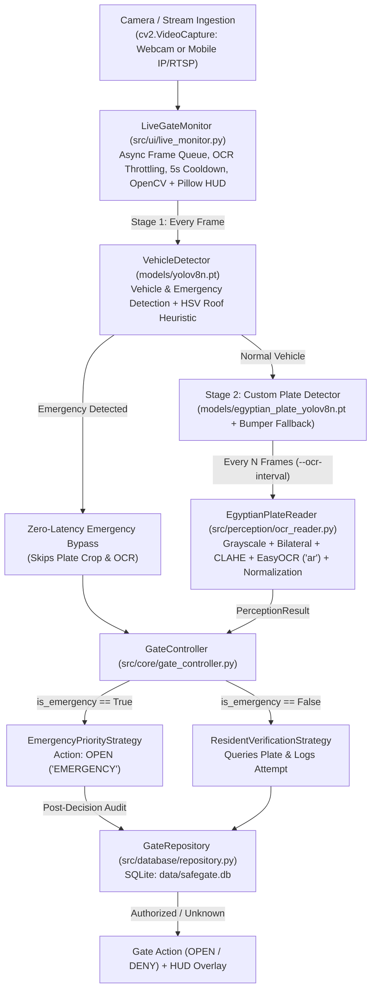

# SafeGate AI — Smart Gate Access Control & Egyptian LPR System

**SafeGate AI** is an autonomous, edge-ready Smart Gate Access Control and License Plate Recognition (LPR) system tailored for Egyptian residential compounds. It combines **Two-Stage YOLOv8 Computer Vision** (vehicle/emergency detection + fine-tuned Egyptian license plate localization), **Arabic OCR** (OpenCV preprocessing + EasyOCR), a **Strategy-driven Decision Engine**, and **SQLite persistence** to automate gate entry in real time with zero-latency emergency vehicle priority.

---

## System Architecture & Design Patterns

SafeGate AI is organized into modular layers following clean object-oriented design patterns:



### Core Design Patterns
- **Pipeline Pattern (`src/perception/pipeline.py`)**: `PerceptionPipeline` chains `VehicleDetector` (Stage 1 vehicle detection & Stage 2 `egyptian_plate_yolov8n.pt` plate localization) and `EgyptianPlateReader` into a single `process_frame(frame)` interface returning `{"is_emergency": bool, "plate_text": str | None, "confidence": float}`.
- **Strategy Pattern (`src/core/access_strategy.py`)**: `GateController` dynamically selects between `EmergencyPriorityStrategy` (instant `OPEN` bypass) and `ResidentVerificationStrategy` (database lookup & logging) via the `AccessStrategy` abstract base class.
- **Repository Pattern (`src/database/repository.py`)**: `GateRepository` encapsulates all `sqlite3` schema creation, resident lookups, and access audit logging (`Residents` and `Access_Logs` tables in `data/safegate.db`).

---

## Directory Structure

```text
Samar/
├── data/
│   └── safegate.db                                      # SQLite database (auto-created)
├── docs/
│   ├── results.png
│   └── safegate_ai_project_architecture_execution_plan.md
├── logs/
│   └── snapshots/                                       # Timestamped HUD snapshots ('s' key)
├── models/
│   ├── yolov8n.pt                                       # Stage 1: Vehicle & general object detector
│   └── egyptian_plate_yolov8n.pt                        # Stage 2: Fine-tuned Egyptian plate detector
├── src/
│   ├── __init__.py
│   ├── core/
│   │   ├── __init__.py
│   │   ├── access_strategy.py                           # AccessStrategy, EmergencyPriorityStrategy, ResidentVerificationStrategy
│   │   └── gate_controller.py                           # GateController orchestrator
│   ├── database/
│   │   ├── __init__.py
│   │   └── repository.py                                # GateRepository (Residents & Access_Logs)
│   ├── perception/
│   │   ├── __init__.py
│   │   ├── detector.py                                  # Two-stage VehicleDetector (YOLOv8 + heuristics)
│   │   ├── ocr_reader.py                                # EgyptianPlateReader (OpenCV + EasyOCR)
│   │   └── pipeline.py                                  # PerceptionPipeline wrapper
│   └── ui/
│       ├── __init__.py
│       └── live_monitor.py                              # LiveGateMonitor (stream, cooldown, HUD)
├── Training/
│   └── egyptian-car-plates-yolov8-fine-tuned.ipynb      # Custom plate detector training notebook
├── main.py                                              # CLI entrypoint (live monitor & simulation)
└── README.md
```

---

## Key Engineering Features

### 1. Zero-Latency Emergency Vehicle Bypass
- `VehicleDetector` inspects detected vehicles for explicit emergency classes (`ambulance`, `fire_truck`, `police`, etc.) as well as an HSV roof-lightbar & white-ambulance visual heuristic (`_evaluate_emergency_heuristic`).
- When `is_emergency` is `True`, `PerceptionPipeline` and `LiveGateMonitor` skip both Stage 2 plate localization and EasyOCR, and `EmergencyPriorityStrategy` immediately returns `OPEN` (`"Emergency Vehicle Bypass"`) without blocking on a database lookup. Audit logging to `Access_Logs` occurs asynchronously/post-decision in `GateController`.

### 2. Two-Stage Plate Localization & Egyptian Arabic OCR
- **Stage 2 Plate Localization (`detect_plate_bbox`)**: Runs the custom `models/egyptian_plate_yolov8n.pt` model on each detected vehicle crop (`conf >= 0.45`) to isolate the tightest license plate `[x1, y1, x2, y2]` bounding box, falling back to a lower-center bumper heuristic if confidence is below `0.45`.
- **OpenCV Preprocessing (`preprocess_plate`)**: Converts crops to grayscale, upscales small plates (`height < 64 px`) by `2x` using bicubic interpolation, applies edge-preserving bilateral filtering (`d=9, sigmaColor=75, sigmaSpace=75`), and enhances local contrast with CLAHE (`clipLimit=2.0, tileGridSize=(8, 8)`), with optional adaptive thresholding.
- **Arabic Normalization (`normalize_plate_text`)**: Filters out low-confidence EasyOCR noise (`conf < 0.4`), strips diacritics/punctuation, unifies Arabic letter variants (`أ`/`إ`/`آ`/`ٱ` → `ا`, `ى`/`ی` → `ي`, `ة` → `ه`, `ک` → `ك`), converts Western/Persian numerals (`0-9` / `۰-۹`) to Arabic-Indic numerals (`٠-٩`), and orders RTL letters + LTR digits to match database records (e.g., `"ا ب ج ١٢٣"`).
- **Pillow Arabic HUD Rendering (`render_hud`)**: Draws color-coded vehicle boxes (**Green** for `GATE OPEN` / Emergency, **Red** for `ACCESS DENIED`, **Yellow** for `SCANNING...`) alongside a distinct **Cyan** (`(255, 255, 0)`) bounding box around localized plates, using Pillow TrueType fonts (`arabic-reshaper` + `python-bidi` when `libraqm` is unavailable) so Arabic plates render cleanly on OpenCV frames.

### 3. Anti-Spam Debounce / Cooldown Timer & Stream Resilience
- **Per-Plate Cooldown (`--cooldown`, default `5.0s`)**: `LiveGateMonitor` caches recent gate decisions per unique plate (and `"EMERGENCY"`) so a car waiting at the gate does not flood `Access_Logs` with duplicate rows.
- **Smooth High-FPS Display**: Inference runs on a background worker thread (`_inference_worker`) that drops stale frames, while heavy EasyOCR is throttled to run every `--ocr-interval` frames (default `10`).
- **Wi-Fi Stream Reconnection**: Automatically releases and reopens `cv2.VideoCapture` if consecutive frame drops exceed `max_frame_failures` (useful for mobile IP Webcam streams over Wi-Fi).

---

## Installation & Setup Guide

### 1. Enable Windows Long Paths (Recommended on Windows)
Deep learning dependencies (`torch`, `ultralytics`, `easyocr`) can exceed Windows' legacy 260-character path limit. Enable Long Paths in an **elevated PowerShell** session:

```powershell
New-ItemProperty -Path "HKLM:\SYSTEM\CurrentControlSet\Control\FileSystem" -Name "LongPathsEnabled" -Value 1 -PropertyType DWORD -Force
```

### 2. Create a Virtual Environment & Install Dependencies
```bash
python -m venv .venv
# Windows PowerShell:
.venv\Scripts\Activate.ps1
# Linux / macOS:
# source .venv/bin/activate

pip install --upgrade pip
pip install torch torchvision ultralytics easyocr opencv-python numpy pillow arabic-reshaper python-bidi
```

> **CUDA / CPU Fallback Handling:**
> Both `VehicleDetector` and `EgyptianPlateReader` check `torch.cuda.is_available()` at initialization. If a CUDA-capable GPU is available, inference runs on `cuda`; otherwise, both models automatically fall back to `cpu` without requiring configuration changes.

### 3. Initialize & Verify the Database
Initialize `data/safegate.db`, create the `Residents` and `Access_Logs` tables, and seed the sample Egyptian resident plates (`"ا ب ج ١٢٣"`, `"س م ر ٤٥٦٧"`, `"ح ب ي ٧٨٩"`):

```bash
python -m src.database.repository
```

---

## Usage & CLI Arguments

| Argument | Default | Description |
| :--- | :--- | :--- |
| `--source` | `"0"` | Video source: local webcam index (e.g., `0`) or mobile IP/RTSP stream URL (e.g., `http://192.168.1.15:8080/video`). |
| `--ocr-interval` | `10` | Run heavy EasyOCR every `N` processed frames (vehicle & plate localization still run smoothly). |
| `--cooldown` | `5.0` | Seconds to debounce duplicate `Access_Logs` database entries per unique plate. |
| `--simulate` | `False` | Run the offline end-to-end integration simulation against `data/safegate.db` without opening a camera. |

### Run Examples

**1. Local Webcam (Default `0`):**
```bash
python main.py
# or explicitly:
python main.py --source 0
```

**2. Mobile IP Camera Stream (e.g., Android IP Webcam / RTSP):**
```bash
python main.py --source http://<IP>:8080/video
```

**3. Custom OCR Throttling & Cooldown:**
```bash
python main.py --source http://192.168.1.15:8080/video --ocr-interval 15 --cooldown 8.0
```

**4. Offline End-to-End Integration Simulation:**
```bash
python main.py --simulate
```

### Interactive Keyboard Controls (Live Window)
- **`s`**: Save a timestamped `.jpg` snapshot of the current annotated HUD frame to `logs/snapshots/`.
- **`q`**: Cleanly release the video stream, close all OpenCV windows, and close the SQLite database connection.

